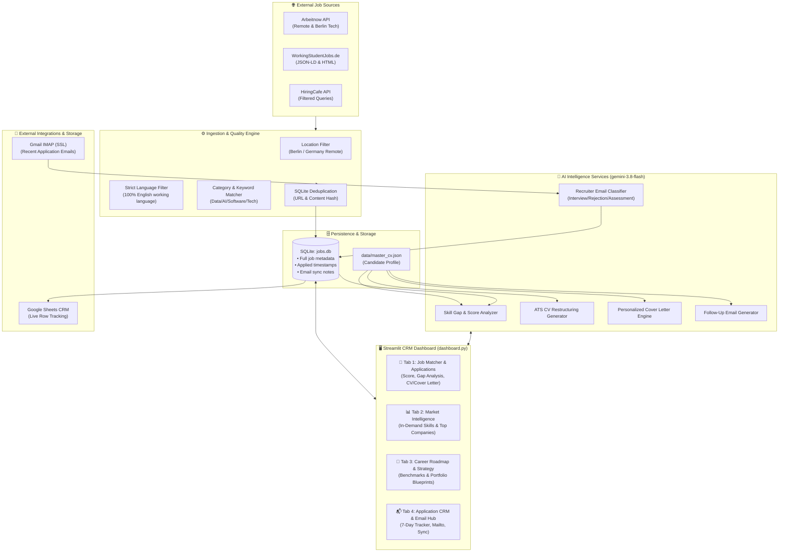
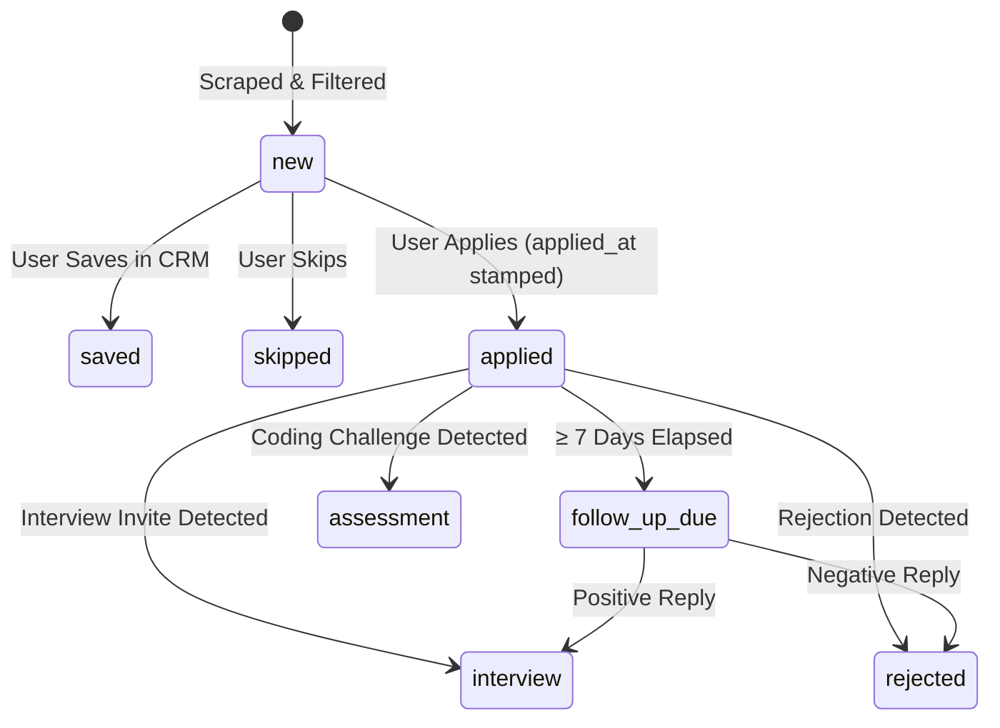

# 🏗️ Architecture & System Design — Job Search CRM & Career Intelligence

This document provides a comprehensive technical breakdown of the architecture, data models, pipelines, and AI integrations powering the **Job Search CRM Assistant**.

---

## 1. High-Level Architecture Overview



---

## 2. Core Subsystems & Components

### 2.1 Data Ingestion & Scrapers (`src/fetchers/`)
The system queries 10 diverse job platforms and company ATS portals concurrently:
- **`indeed.py`**: Direct Indeed Germany fetcher using python-jobspy, querying Berlin working student and internship roles across Data, AI, and Software domains.
- **`greenhouse.py`**: Direct REST API client for 20+ top Berlin & German tech companies (HelloFresh, SumUp, N26, GetYourGuide, Celonis, Solaris, Raisin, etc.).
- **`personio.py`**: XML syndication fetcher for leading Berlin startups and scaleups using Personio ATS (Taxfix, Sennder, Tourlane, Clue, Y42, Deepset, Parloa, etc.).
- **`berlinstartupjobs.py`**: RSS feed parser for Berlin's local startup ecosystem tech and internship roles.
- **`linkedin.py`**: Scraper targeting Berlin and Germany-wide student tech roles on LinkedIn.
- **`workwise.py`**: Workwise category hubs and real-time enquiry focus sitemap parser with schema.org JSON-LD extraction.
- **`jobteaser.py`**: European & German university career portal scraper focusing on student and internship listings.
- **`arbeitnow.py`**: REST API client for Arbeitnow's English-speaking, flexible EU/Germany listings.
- **`workingstudentjobs.py`**: Targeted German university working student portal scraper with schema.org/JobPosting JSON-LD parser.
- **`hiringcafe.py`**: Search queries indexing direct company websites.

### 2.2 Strict Quality & Language Filter Pipeline (`src/filters.py`)
Quality control runs through a 3-tier deterministic filter pipeline before any job reaches the database:
1. **Location Filter:**
   - Matches keywords: `berlin`, `remote in germany`, `deutschlandweit remote`, `hybrid berlin`.
2. **Strict English Filter (`is_english_role`):**
   - Eliminates jobs requiring conversational or fluent German.
   - Rejection patterns: `command of german`, `german alongside english`, `deutschkenntnisse`, `verhandlungssicher in deutsch`, `c1/b2 deutsch`.
   - Permitted exceptions: Mentions of German university enrollment (`enrolled at a german university`) or purely optional skills (`german is a plus`).
3. **Category & Tech Matcher:**
   - Filters for relevant technology, data, software, and AI roles, calculating an initial relevance score.

### 2.3 Persistence Layer (`src/database.py`)
Data is stored locally in SQLite (`data/jobs.db`). The schema includes:
```sql
CREATE TABLE IF NOT EXISTS jobs (
    id INTEGER PRIMARY KEY AUTOINCREMENT,
    job_id TEXT UNIQUE,
    source TEXT,
    title TEXT,
    company TEXT,
    location TEXT,
    url TEXT UNIQUE,
    language TEXT,
    is_remote INTEGER,
    is_berlin INTEGER,
    category TEXT,
    match_score INTEGER,
    description TEXT,
    posted_at TEXT,
    fetched_at TEXT,
    status TEXT DEFAULT 'new',
    sheet_row INTEGER,
    created_at TEXT,
    applied_at TEXT DEFAULT '',
    email_notes TEXT DEFAULT ''
);
```

#### Status Lifecycle:


---

## 3. AI Services & Prompt Architecture (`src/ai_assistant.py`, `src/email_tracker.py`)

All AI capabilities use **`gemini-3.8-flash`** (with automatic model fallback) for minimal latency and high parsing accuracy.

### 3.1 Skill Gap & Match Analysis (`src/match_analyzer.py`)
- Analyzes candidate profile (`data/master_cv.json`) against the scraped job description.
- Returns:
  - **Matched Skills** (rendered in green badges).
  - **Missing Skills** (rendered in red badges).
  - **General Market Skills** (rendered in blue badges).
  - **Dynamic Match Score (0–100%)**.

### 3.2 ATS CV Restructuring Engine
- Rewrites experience and project bullet points to naturally incorporate missing skills without falsifying experience.
- Produces clean, copy-paste ready bullet points with an updated ATS match estimate.

### 3.3 Personalized Cover Letter Generator
- Crafts a role-specific, 300-word cover letter in English highlighting relevant university coursework, thesis topic, and practical tech stack.
- Formats text for instant export to `.docx` and editable plain text.

### 3.4 7-Day Follow-Up Email Assistant
- Triggers when an applied position has had no response for 7+ days.
- Drafts a concise (120–160 words) polite follow-up email inquiring on application progress.
- Includes pre-filled `mailto:` links with URL-encoded subject and body for 1-click email client handoff.

### 3.5 Gmail AI Sync & Email Classifier (`src/email_tracker.py`)
- Connects to Gmail over IMAP SSL (`imap.gmail.com:993`).
- Scans recent emails with keywords (`application`, `interview`, `bewerbung`, `status`).
- Gemini classifies the email into structured JSON:
  ```json
  {
    "is_job_related": true,
    "category": "INTERVIEW",
    "company": "Bain & Company",
    "position": "Working Student Data Analytics",
    "summary": "Invited for a 45-minute technical interview via Calendly.",
    "next_step": "Select interview slot by Friday."
  }
  ```
- Automatically updates SQLite database records and appends audit notes.

---

## 4. User Interface Architecture (`dashboard.py`)

The web UI is built using Streamlit in a wide-layout multi-tab structure:

1. **Top Metric Bar:**
   - Real-time counters: Total Jobs, Applied, Interviews/Assessments, Saved, Rejected, Application Rate.
2. **Tab 1: Market Intelligence:**
   - Plotly bar charts visualizing top in-demand skills in the Berlin tech market.
   - Company hiring leaderboards.
3. **Tab 2: Job Matcher & AI Optimizer:**
   - Master-Detail card feed with sort options (Newest, Oldest, Best Match).
   - Live skill gap visualizer.
   - 1-click CV optimization and cover letter generation.
4. **Tab 3: CRM Follow-Up & Gmail Hub:**
   - **Sub-tab 1: Application Tracker & Calendar:** Lists active applications, calculates elapsed days, highlights 7-day follow-up requirements, and provides the AI follow-up generator.
   - **Sub-tab 2: Gmail Sync & Interactive Simulator:** Live IMAP mailbox scanner alongside an interactive email classifier simulator with pre-configured test scenarios (Bain, Personio, Delivery Hero).

---

## 5. Security, Reliability & Privacy Principles

- **Credential Isolation:** API keys and Google App Passwords reside exclusively in `.env` (strictly excluded by `.gitignore`).
- **In-Memory Mail Processing:** Incoming emails are fetched over TLS, analyzed in transient memory, and never cached to disk.
- **Fail-Safe UI:** In the absence of external API credentials (e.g., if Gmail App Password is not yet set), all manual features, simulators, and UI components remain fully operational.
